<div align="center">

# HackElite

### Every open hackathon, ranked for **you**.

Live listings from 16 sources, a resume-aware recommendation engine that explains its scores,<br>
an AI agent for every event, calendar sync, and private team chat, all on one MongoDB.


[**Quick start**](#-quick-start) · [**Features**](#-features) · [**Free vs Pro**](#-free-vs-pro) · [**Architecture**](#-how-it-works) · [**Docs**](#-documentation)

<br>

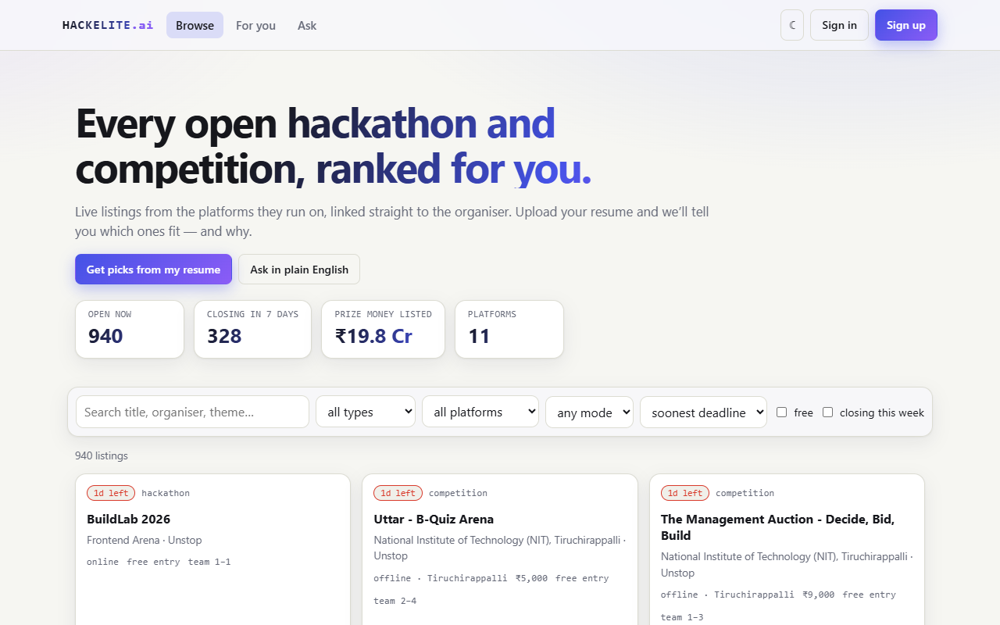

</div>

---

## Why HackElite

Hackathons, case competitions and coding contests are scattered across Devpost, Unstop, Devfolio, MLH, Kaggle, Codeforces and a dozen more sites. Deadlines slip, people apply to events they are not eligible for, and finding teammates is a separate chore.

**HackElite puts every open event in one place, tells you which ones fit *you* and why, answers questions about any single event, keeps the deadlines in your own calendar, and lets you team up and chat privately.**

## ✨ Features

<table>
<tr>
<td width="50%" valign="top">

### 🔎 Discover
- **16 live sources**, refreshed hourly, validated and **de-duplicated across sites**
- Search, filter, sort; **cards expand in place** with every detail
- **Ask in plain English**: *"offline hackathons in pune closing soon with 1L+ prize"*. A named place is a hard filter, so Bangalore never returns Dhaka

### 🎯 Recommendations that explain themselves
- **Resume Studio**: drop a PDF/DOCX once; skills, interests and graduation year are inferred (parsed in memory, the file is never stored)
- **Explainable 0-100 score** from an 8-criterion rubric: skills, semantic fit, location, interests, preferences, eligibility, timing, prize-vs-competition
- Hard filters hide events you **cannot enter** (education level, graduation batch)

### 🤖 Ask any hackathon
- An agent reads **that event's own site** (FAQ, rules, schedule), politely: `robots.txt`, one request a second, same-site only, **SSRF-safe**
- Answers cite sources and say honestly when a page can't be read

</td>
<td width="50%" valign="top">

### 📅 Never miss a deadline
- **Register click** saves the event to your **tracker** as *applied*
- **Add to Google / Outlook / Apple**, or turn on a **live private calendar feed** with your own reminders
- **Email reminders** before deadlines (verified, opt-in, idempotent)

### 👥 Team up
- **Connect** with people (opt-in discovery, never shows your email), **live DMs** over WebSockets
- **Teams with a private room**, invites by connection or email, tracker **Team up** button
- **Pro**: teammate and open-team recommendations (complementary skills, shared hackathons), plain-English people search, idea voting
- Live notifications, unread badges, block/leave controls

### 🛡️ Built to be trusted
- Revocable JWT sessions, lockout, breach-checked passwords, SSRF/NoSQL/XSS defences
- **Personal data stays private**, proven with two-user tests; full account erasure

</td>
</tr>
</table>

### Screenshots

| | |
|:--:|:--:|
| **Resume Studio + explainable picks**<br>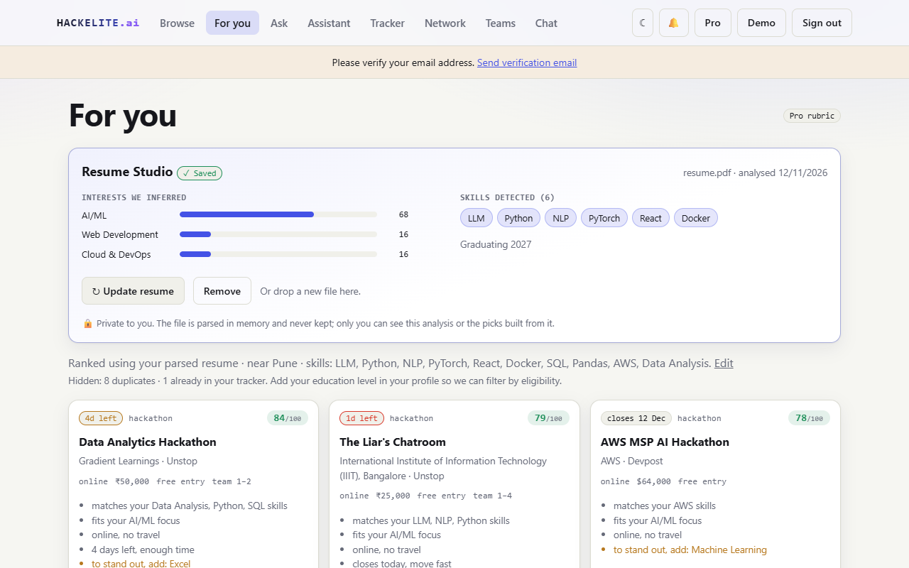 | **Click a card: every detail, in place**<br>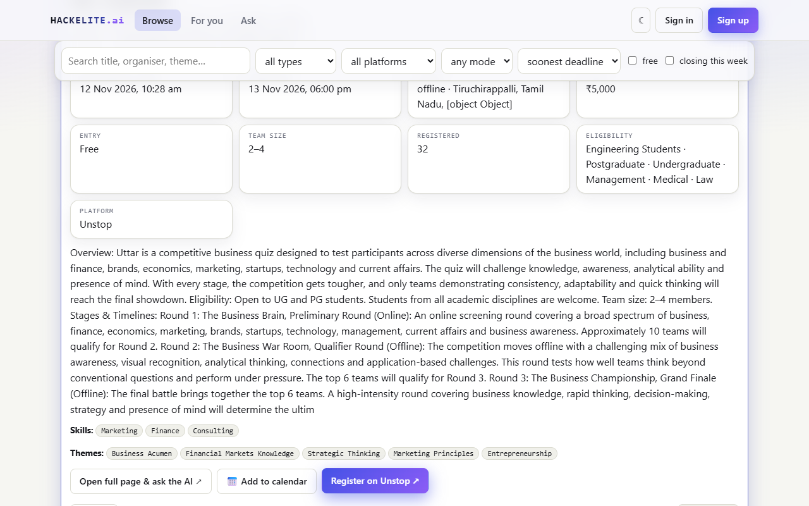 |
| **Ask about this hackathon (cited answers)**<br>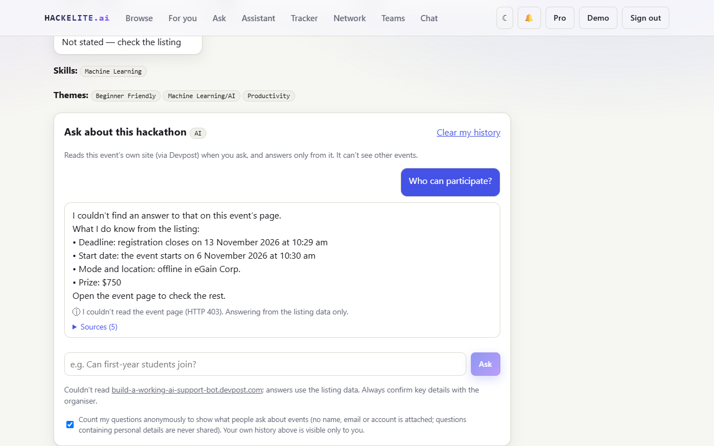 | **Tracker + live calendar sync**<br>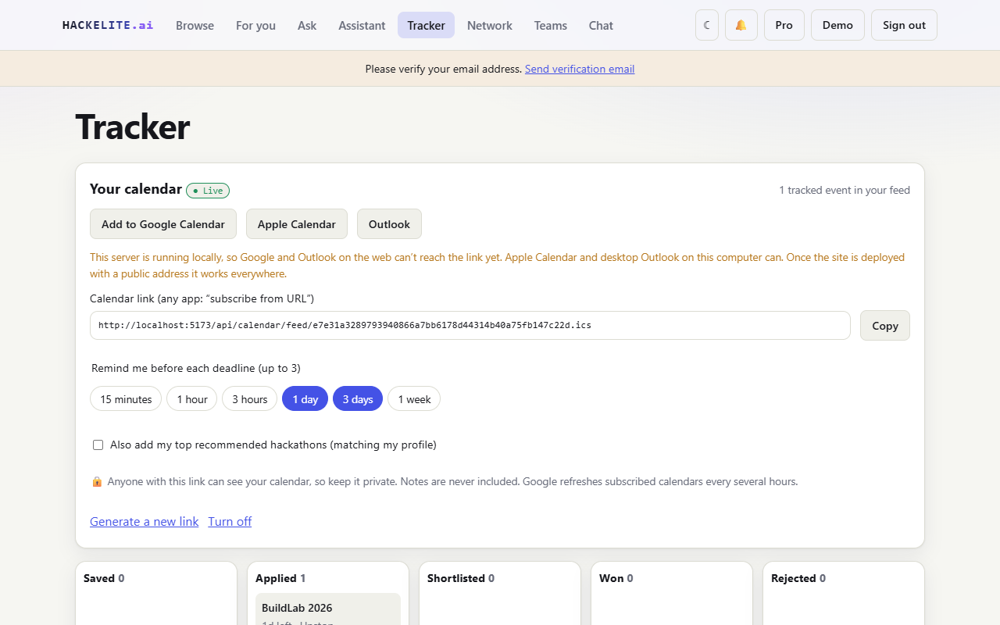 |
| **Network: requests, people, suggestions**<br>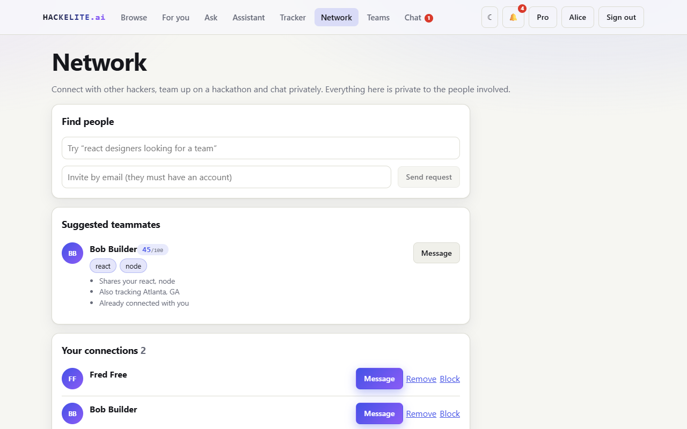 | **Live private chat**<br>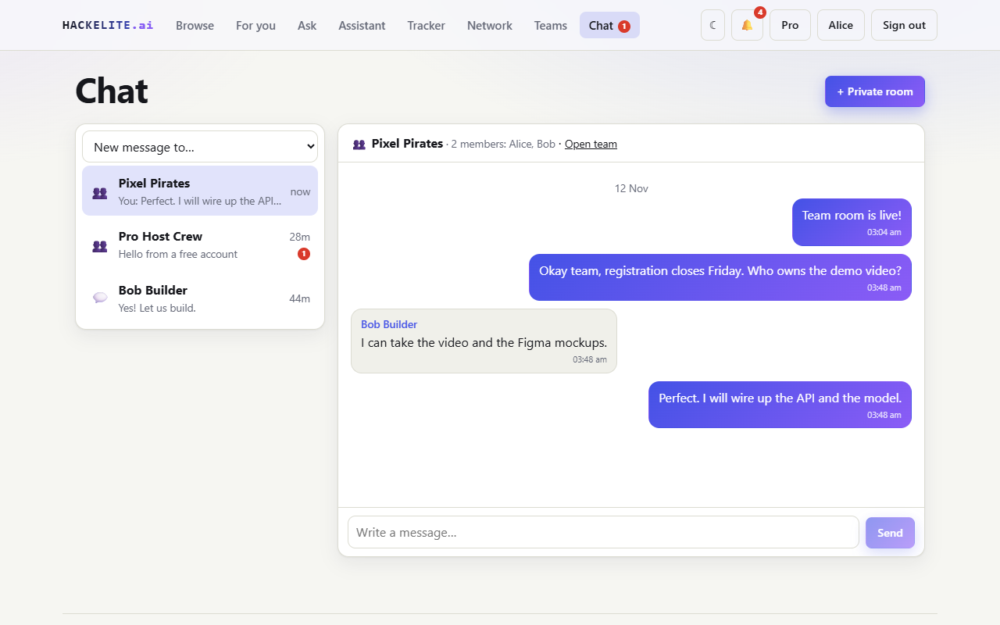 |
| **Team room, invites and idea board**<br>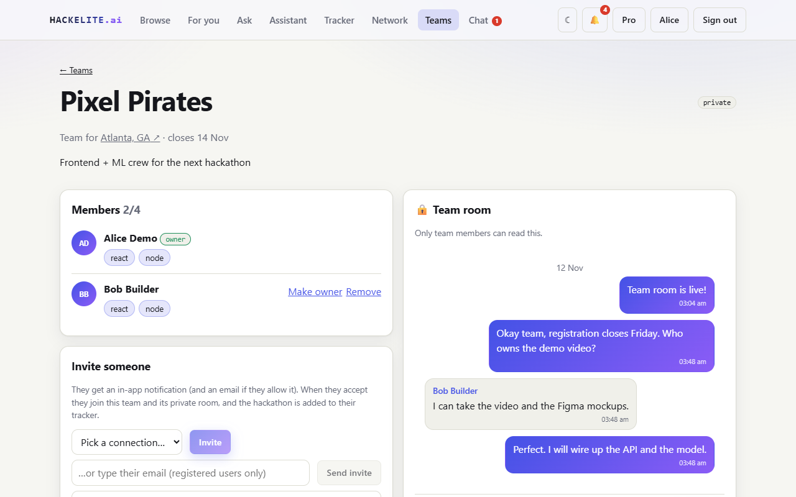 | **Dark mode and mobile**<br>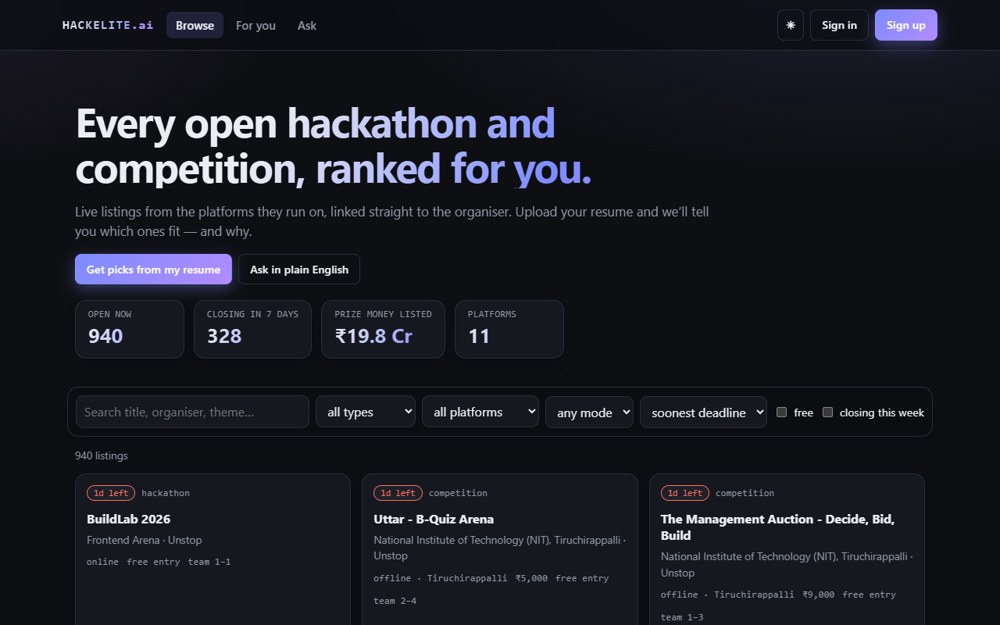 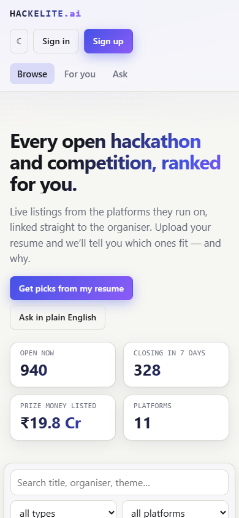 |

## 💎 Free vs Pro

| | **Free** | **Pro** |
|---|:--:|:--:|
| Browse, search, filter, expand cards, Ask in plain English | ✅ | ✅ |
| Tracker, Register → tracker, notifications, **email reminders** | ✅ | ✅ |
| Add to Google/Outlook/Apple + **live calendar feed** | ✅ | ✅ |
| Ask any hackathon (per-event agent) | ✅ | ✅ |
| Connect with people, **live direct messages**, block | ✅ | ✅ |
| **Join** a team or private room you are invited to, and chat | ✅ | ✅ |
| Basic picks from your skills and interests | ✅ | ✅ |
| Resume upload and analysis | ❌ | ✅ |
| Full **8-criterion** recommendation rubric with explanations | ❌ | ✅ |
| RAG assistant with citations | ❌ | ✅ |
| **Host** hackathon teams with a private room, invite people, tracker **Team up**, private rooms | ❌ | ✅ |
| Teammate + open-team recommendations, plain-English people search, public teams, idea voting | ❌ | ✅ |

> Pro is activated with a key (`PRO_ACTIVATION_KEYS` in `.env`; the public demo key must be changed before deploying). Rules and rationale: [docs/SOCIAL.md](docs/SOCIAL.md).

## 🚀 Quick start

**Requirements:** Node 20+ (`nvm use` reads `.nvmrc`). MongoDB is optional: the dev command starts a real one for you.

```bash
git clone https://github.com/MUKUL-PRASAD-SIGH/FSD.git && cd FSD
npm install                 # root tooling
npm run setup               # server + client dependencies
cp .env.example .env        # set JWT_SECRET, ADMIN_EMAIL, ADMIN_PASSWORD (see below)
npm run dev                 # MongoDB + API :5050 + web :5173, all in one terminal
```

Open **http://localhost:5173**. The API pulls live listings on boot (after ~3 s), then hourly.

| First-run detail | |
|---|---|
| Generate `JWT_SECRET` | `node -e "console.log(require('crypto').randomBytes(48).toString('hex'))"` |
| Admin account | created from `ADMIN_EMAIL` / `ADMIN_PASSWORD` on start (password needs 10+ chars, upper/lower, digit, symbol) |
| Try Pro | sign in → **Upgrade** → paste a key from `PRO_ACTIVATION_KEYS` |
| Own MongoDB / Atlas | set `MONGO_URI`, then `npm run dev:nodb` |
| Everything offline | works without any external key; Google, Gemini and SMTP are optional upgrades ([docs/ENV_SETUP.md](docs/ENV_SETUP.md)) |

**Docker (one machine, production-like):** `npm run docker:up` → http://localhost:5050 (app + MongoDB, health-checked). More in [docs/DEPLOYMENT.md](docs/DEPLOYMENT.md).

### Commands

| Command | What it does |
|---|---|
| `npm run dev` | MongoDB + API + web with hot reload |
| `npm run dev:nodb` | API + web only (bring your own MongoDB) |
| `npm test` | 114 tests: unit, integration, in-process journey (real MongoDB, real WebSockets) |
| `npm run e2e` | **live end-to-end**: boots the real server process and runs the 41-check product journey |
| `npm run verify` | tests + client build + live e2e (the gate before merging) |
| `npm run build` | production client build |
| `npm run ingest` · `sources:check` · `integrations:check` | refresh listings · probe all 16 sources · probe Gemini/SMTP/Google with your keys |
| `npm run docker:up` / `docker:down` | run / stop the container stack |

## 🧠 How it works

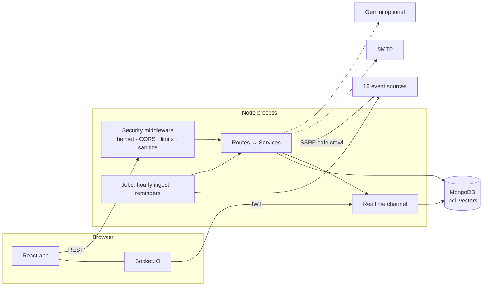

- **Ingestion**: adapters → validate → de-duplicate across sites → upsert; one broken source never blocks another, and events are only removed after a *complete* sync.
- **Recommendations**: hard filters (expired / ineligible / duplicate) → weighted rubric → score + plain-English reasons; same input, same order. Embeddings live in MongoDB (local hashing model, or Gemini).
- **Realtime**: Socket.IO on the API port; the **server** decides which rooms a socket joins; sessions revoked by a password change are disconnected instantly.
- **Privacy by construction**: discovery is opt-in, emails never leave the account, room access is membership-only, and anonymous question analytics store no user id.

The full tour with file paths and low-level mechanics is in **[docs/CODEBASE_GUIDE.md](docs/CODEBASE_GUIDE.md)**.

## 🗂️ Project structure

```
.
├── client/            React 19 + Vite app (pages, chat, calendar, resume studio, live realtime)
├── server/            Node + Express API
│   ├── routes/        HTTP layer (13 files, 105 routes)
│   ├── services/      business logic: recommender, rag, teams, chat, calendar, pageAgent, ingest/ …
│   ├── models/        16 Mongoose schemas
│   ├── middleware/    auth · security · ops
│   ├── utils/         safeFetch (SSRF-safe), pii, geo, password …
│   ├── scripts/       dev-db · e2e-live · source-check · check-integrations
│   └── tests/         13 test files + the shared product journey
├── docs/              all documentation (start at docs/README.md)
├── e2e/               optional Playwright browser journeys
├── .github/           CI, issue and PR templates, dependabot
└── Dockerfile · docker-compose.yml · package.json (root scripts)
```

## ✅ Testing

```text
$ npm run e2e
1 · Platform: health, headers, request ids, limits              ✔✔✔
2 · Accounts: sign-up, verification, login, profile, reset       ✔✔✔✔✔
…
7 · Network, live chat, hackathon teams and the Free/Pro split  ✔✔✔✔✔✔✔✔✔✔✔✔
…
ALL 41 CHECKS PASSED  (real server process, isolated database)
```

Real MongoDB, real WebSocket clients, real PDF fixtures. The live run once caught a bug no unit test could (a valid PDF upload returning 500 in the real server). Layers, every test file and debugging switches: [docs/TESTING.md](docs/TESTING.md). CI runs it all plus `npm audit` and a Docker build on every push.

## 🔐 Security and privacy at a glance

| | |
|---|---|
| **Sessions** | HS256 JWT + `tokenVersion`: password change, disable or "sign out everywhere" revokes every token **and** live socket |
| **Passwords** | bcrypt (cost 12), lockout, breached-password check via k-anonymity, generic errors (no account enumeration) |
| **Input** | NoSQL-injection and prototype-pollution scrubber, 200 KB body cap, magic-byte upload check |
| **Crawler** | resolves and **pins** to public IPs only, per-hop redirect checks, robots.txt + Crawl-delay, never fetches user-generated areas |
| **Chat** | membership-only access, text only, server-decided socket rooms, per-socket rate limit |
| **Privacy** | personal routes `no-store`; resume file never stored; opt-in discovery; anonymous question tally; full erasure |

Every control is listed with the test that proves it in [docs/SECURITY.md](docs/SECURITY.md), including an honest list of known gaps. To report a vulnerability see [SECURITY.md](SECURITY.md).

## 🧰 Tech stack
Node.js · Express 4 · MongoDB/Mongoose · React 19 · Vite · React Router · Socket.IO · JWT · bcryptjs · helmet · express-rate-limit · cheerio · pdf-parse · mammoth · nodemailer · google-auth-library · Docker · GitHub Actions · `node:test`. Optional: Google Gemini (answers + embeddings).

## 📚 Documentation

| | |
|---|---|
| **[docs/CODEBASE_GUIDE.md](docs/CODEBASE_GUIDE.md)** | **start here**: every feature, file paths, low-level mechanics, demo script, likely questions |
| [docs/API.md](docs/API.md) | all 105 routes with access rules + WebSocket protocol |
| [docs/ARCHITECTURE.md](docs/ARCHITECTURE.md) | flows, recommender, ingestion, RAG, operations |
| [docs/SECURITY.md](docs/SECURITY.md) | controls, tests, known gaps |
| [docs/SOCIAL.md](docs/SOCIAL.md) | network, teams, chat, Free vs Pro |
| [docs/CRAWLER.md](docs/CRAWLER.md) | crawler conduct and question privacy |
| [docs/DEPLOYMENT.md](docs/DEPLOYMENT.md) | Docker, proxy + WebSockets, scaling, go-live checklist |
| [docs/TESTING.md](docs/TESTING.md) | test layers and the live end-to-end run |
| [docs/ENV_SETUP.md](docs/ENV_SETUP.md) | where to get every key |
| [docs/IMPLEMENTATION_STATUS.md](docs/IMPLEMENTATION_STATUS.md) | what is verified, what is not |
| [CONTRIBUTING.md](CONTRIBUTING.md) | set up, checks, conventions |

## 🗺️ Known limits and roadmap
- Some sources are unofficial endpoints (DoraHacks is bot-walled and skipped; Kaggle and clist need free keys). Pages rendered only by JavaScript give the per-event agent just the listing data.
- Pro is key-based; **next:** payments, chat moderation (report/delete), headless-browser crawling, Redis for multi-instance scale-out.
- One server instance today (jobs and sockets run in-process); the scale-out path is documented in [docs/DEPLOYMENT.md](docs/DEPLOYMENT.md#7-scaling-honest-limits).
- The previous version of the project is kept in [`old/`](old/) for reference.

## 🤝 Contributing
Pull requests are welcome: read [CONTRIBUTING.md](CONTRIBUTING.md), run `npm run verify`, and keep docs in step with code. This repository does not yet declare a licence; add a `LICENSE` file before accepting outside contributions.
