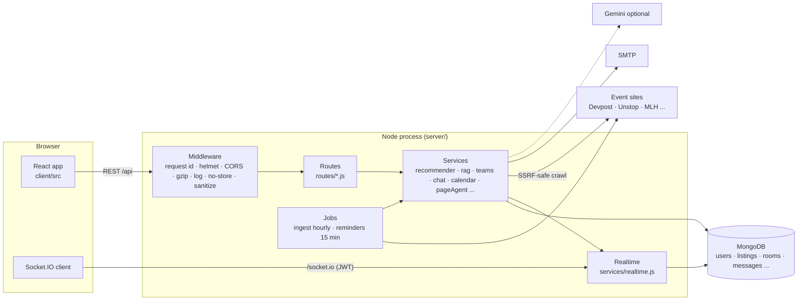

# HackElite: complete code guide

One document that explains **what the project does, how it is built, where every important piece of code lives, how it works at low level, and how to present it.** Read Part 1 and 2 for the big picture; use Part 3 as a feature-by-feature reference; use Part 4 to rehearse the explanation.

**How to use it**
- Presenting to a teacher or examiner? Read **Part 1** (pitch), **Part 2** (architecture), skim **Part 3**, then rehearse with **Part 4** (demo script and likely questions).
- Joining the project? Read Parts 2 and 3, then [CONTRIBUTING.md](../CONTRIBUTING.md).
- All paths are relative to the repository root. `server/` is the Node.js API, `client/` is the React app.

---

# Part 1 · The big picture

## 1.1 The problem
Students find hackathons, case competitions and coding contests scattered across 15+ sites (Devpost, Unstop, Devfolio, MLH, Kaggle, Codeforces…), each with its own format. Deadlines get missed, people enter events they are not eligible for, and nobody knows which events actually fit their skills, city and schedule. Finding teammates is a second, separate problem.

## 1.2 The solution in one sentence
**HackElite pulls every open event into one place, ranks them for you using your resume and profile (and explains why), lets you ask questions about any single event, keeps your deadlines in your own calendar, and lets you team up and chat privately.**

## 1.3 What it does (the feature map)

| # | Feature | One-line explanation | Plan |
|---|---|---|---|
| 1 | **Live aggregation** | 16 adapters ingest events hourly, validate, de-duplicate across sites | everyone |
| 2 | **Browse, search, filter** | fast API + cards that expand in place | everyone |
| 3 | **Accounts and security** | email/password + Google, email verification, sessions you can revoke | everyone |
| 4 | **Ask in plain English** | "offline hackathons in pune closing soon with 1L+ prize" → filters + ranking | everyone |
| 5 | **Resume analysis** | upload a PDF/DOCX → skills, interests, graduation year | Pro |
| 6 | **Recommendation engine** | explainable 0-100 score from an 8-criterion rubric | basic free, full Pro |
| 7 | **RAG assistant** | chat that answers only from retrieved listings and your resume, with citations | Pro |
| 8 | **Tracker and reminders** | save, mark applied, notes; Register click auto-tracks; email reminders | everyone |
| 9 | **Calendar integration** | Google/Outlook links, personalised `.ics`, live private feed | everyone |
| 10 | **Per-hackathon agent** | crawls that event's own site politely and answers questions about it | everyone (sign-in) |
| 11 | **Network and DMs** | connect with people, live direct messages | everyone |
| 12 | **Teams and private rooms** | host teams with a private room, invites, tracker "Team up" | Pro host; invitees free |
| 13 | **Smart matching** | teammate and open-team recommendations, smart people search, idea voting | Pro |
| 14 | **Organiser portal** | event organisers publish validated events after admin approval | role |
| 15 | **Admin console** | source health, users, moderation, audit log, integrations check | role |
| 16 | **Operations** | health checks, structured logs, Docker, CI, end-to-end tests | platform |

## 1.4 Technology and why
| Choice | Why |
|---|---|
| **Node.js + Express 4** | one language across stack; simple, explicit middleware pipeline |
| **MongoDB + Mongoose** | flexible documents fit heterogeneous event data; TTL indexes expire caches; **vectors are stored in MongoDB too**, so there is no separate vector database |
| **React 19 + Vite + React Router** | fast dev loop, small bundle (≈135 KB gzipped), no UI framework dependency |
| **Socket.IO** | reliable WebSocket with fallbacks, rooms and acknowledgements for live chat/notifications |
| **JWT (HS256) + `tokenVersion`** | stateless sessions that can still be revoked instantly |
| **cheerio** | HTML extraction for the per-event agent and HTML-only sources |
| **pdf-parse, mammoth** | resume text from PDF/DOCX |
| **nodemailer** | SMTP email (verification, reset, reminders, invites) |
| **Gemini (optional)** | fluent answers and better embeddings; everything works without it |
| **node:test** | built-in test runner, no extra framework |

**Deliberate design principles** (these are good things to say out loud):
1. **Explainable over magical**: recommendations are a deterministic weighted rubric; every score comes with reasons.
2. **Works without paid APIs**: local embeddings, rule-based parsing, extractive answers. Gemini only upgrades quality.
3. **Authorisation on the server**: the UI only hides buttons; every rule is enforced in the API and proven by tests.
4. **Privacy by construction**: personal data is private by default and isolation between users is tested with two accounts.
5. **Untrusted input everywhere**: listing text, crawled pages, uploaded files and chat text are treated as data, never as instructions or HTML.

---

# Part 2 · Architecture

## 2.1 System diagram



## 2.2 Life of a request (low level)
`server/server.js` → `buildApp()` builds the pipeline in this exact order:

1. `requestId` (`middleware/ops.js`): attaches/echoes `X-Request-Id`.
2. `applySecurity` (`middleware/security.js`): `helmet` headers, strict CSP for the API, CORS allow-list (`CLIENT_ORIGIN`), global rate limiter (300/min/IP).
3. `compress` (gzip), `accessLog` (one JSON line per request in production).
4. `privateNoStore`: any personal path (`/api/me`, `/auth`, `/network`, `/teams`, `/chat`, …) gets `Cache-Control: private, no-store` so shared caches never keep personal data.
5. `express.json({limit:'200kb'})` then `sanitize` (`utils/sanitize.js`): strips keys starting with `$` or containing `.` and the `__proto__` family from body/query/params → blocks NoSQL injection and prototype pollution.
6. Routers mounted under `/api/...`.
7. `notFound` and `errorHandler` (`utils/http.js`): maps Mongoose/validation errors to 4xx and **never** leaks stack traces; passes through string error codes such as `PRO_REQUIRED`.

`asyncRoute()` wraps every async handler because Express 4 does not catch rejected promises.

On start (`start()` in `server/server.js`): validate env → connect MongoDB → `migrate()` (fix legacy data) → `ensureAdmin()` (create first admin from env) → listen → `realtime.init(server)` → schedule ingestion (3 s after start, then hourly; each run is followed by `afterIngest`: embed new listings, then generate notifications) → schedule reminders (every 15 min) → register graceful shutdown (`SIGTERM`: stop accepting, close sockets, close MongoDB).

## 2.3 Repository map

```
.
├── README.md                    project front page
├── CONTRIBUTING.md · SECURITY.md · package.json (root scripts) · Dockerfile · docker-compose.yml
├── .github/                     CI workflow, issue/PR templates, dependabot
├── docs/                        ← all documentation (this file lives here)
│   ├── CODEBASE_GUIDE.md        this guide
│   ├── ARCHITECTURE.md · SECURITY.md · SOCIAL.md · CRAWLER.md · API.md · DEPLOYMENT.md · TESTING.md · ENV_SETUP.md
│   ├── IMPLEMENTATION_STATUS.md what is verified vs not
│   ├── assets/                  README screenshots
│   └── reports/                 historical audit/test reports
├── client/                      React app (Vite)
│   └── src/ main.jsx · App.jsx · api.js · auth.jsx · realtime.jsx · toast.jsx · components.jsx · layer.css/styles.css
│        pages/ (Home, ForYou, Ask, Assistant, Tracker, Network, Teams, TeamPage, Chat, Profile, Plan, Lister, Admin, Auth, …)
│        ResumeStudio · ChatPane · HackathonAgent · AddToCalendar · CalendarSync · ShareModal · SocialSettings · data/india.js
├── server/                      Node/Express API
│   ├── server.js                app assembly, start-up, jobs, shutdown
│   ├── config/                  env.js (validated config) · db.js
│   ├── middleware/              auth.js · security.js · ops.js
│   ├── models/                  Mongoose schemas (16)
│   ├── routes/                  HTTP layer (13 files, 105 routes)
│   ├── services/                business logic (+ ingest/ with 14 adapter files)
│   ├── utils/                   safeFetch · pii · geo · password · breached · sanitize · serialize · http · listingInput · seed
│   ├── scripts/                 dev-db.js · e2e-live.js · source-check.js · check-integrations.js
│   └── tests/                   13 test files + helpers/journey.js + fixtures/
├── e2e/journeys.js              optional Playwright browser journeys
├── scripts/setup-dev-tools.sh   helper for browser tooling
└── old/                         the previous version of the project, kept for reference
```

## 2.4 Data model (MongoDB collections)

| Collection (model file `server/models/`) | Key fields | Important indexes / lifecycle |
|---|---|---|
| **users** (`User.js`) | `email`, `password` (bcrypt cost 12, never selected), `role` user/lister/admin, `status`, `tokenVersion`, lockout (`failedLogins`,`lockUntil`), `emailVerified`, `plan{tier}`, profile, `resume{skills,domains,text*,chunks*}` (`*` = `select:false`), `social{discoverable,…}`, `privacy`, `calendar{token*,reminders,includePicks}`, `notify{…}` | unique email; sparse unique `calendar.token`; hooks: bump `tokenVersion` on password change and disconnect sockets |
| **listings** (`Listing.js`) | title, organiser, `type`, `mode`, `deadline`+`deadlineKind`, city/state/country, prize (label, INR, original currency), fee, team size, eligibility[], skills[], `source`+`externalId`, `alsoOn[]`, `embedding*` | text-search friendly fields; embedding stored with its model name |
| **saveds** (`Saved.js`) | `user`, `listing`, `status` saved/applied/shortlisted/rejected/won, `note` | unique (user, listing) |
| **notifications** (`Notification.js`) | `user`, `type`, `title`, `link`, `readAt` | unique (user, listing, type) so re-runs never duplicate |
| **sourcesyncs** (`SourceSync.js`) | per-source counts, pagination-complete flag, errors | kept ~90 days (TTL) |
| **auditlogs** (`AuditLog.js`) | append-only security events | written fire-and-forget |
| **connections** (`Connection.js`) | `pair` (two ids sorted), `requester`, `recipient`, `status` | unique `pair` ⇒ no duplicate relationship in either direction |
| **invites** (`Invite.js`) | `kind` team_invite/team_request/room_invite, from, to, `target`, status | partial unique index on pending ⇒ idempotent invites; TTL 14 d (30 d once resolved) |
| **teams** (`Team.js`), **rooms** (`Room.js`), **messages** (`Message.js`), **ideas** (`Idea.js`) | team members/capacity/visibility; room kind dm/team/group with `members[{lastReadAt}]`; plain-text messages; ranked votes | `members.user` indexes; unique sparse `dmKey`; messages indexed (room, createdAt) |
| **listingpages** (`ListingPage.js`) | cached crawl: pages, passages, FAQ | TTL 6 h (10 min on failure) |
| **listingquestions** (`ListingQuestion.js`) | anonymous question tally, **no user id** | TTL 365 d |
| **userqueries** (`UserQuery.js`) | a user's own agent conversation | TTL 180 d; deleted with the account |
| **reminderlogs** (`ReminderLog.js`) | which reminder was sent | unique (user, listing, lead time); TTL 60 d |

---

# Part 3 · Feature reference (high level → low level)

Each chapter has: **What the user sees → How it works (high level) → Where the code is → Low-level mechanics → Tests.**

## 3.1 Foundation: configuration, security middleware, errors
**High level.** One validated config object, a fixed middleware order, safe errors, and health endpoints.

| Path | Role |
|---|---|
| `server/config/env.js` | reads every env var once into `config`; `validate()` refuses unsafe production config (short/default `JWT_SECRET`, no `PRO_ACTIVATION_KEYS`, `CLIENT_ORIGIN=*`) |
| `server/config/db.js` | `connectDB()`; `MONGO_DB_NAME` lets tests use isolated databases |
| `server/middleware/security.js` | helmet, CORS allow-list, `trust proxy`, limiters: global, `authLimiter` (30/15 min), `heavyLimiter` (20/min), `messageLimiter` (120/min), `feedLimiter` (3000/min) |
| `server/middleware/ops.js` | request id, JSON access log, `privateNoStore`, gzip |
| `server/utils/sanitize.js` | NoSQL-injection / prototype-pollution scrubber (no extra dependency) |
| `server/utils/http.js` | `asyncRoute`, `notFound`, `errorHandler` |

**Low level notes.** Rate limiters are skipped in tests and when `DISABLE_RATE_LIMITS=1` outside production (used by the live E2E). The error handler turns Mongoose `ValidationError`, `CastError` (bad ObjectId → 400/404), duplicate-key `11000` (→ 409) and Multer size errors into clean messages. Health: `/api/health` (alive) and `/api/health/ready` (503 until MongoDB connected).

**Tests.** `tests/e2e.test.js` (headers, CORS, limits, injection, prototype pollution), journey phase 1.

## 3.2 Accounts, sessions and password security
**What the user sees.** Sign up (strength meter), verify email, sign in (email or Google), change/reset password, sign out everywhere, delete account.

**High level.** Passwords are hashed; sessions are JWTs that can be revoked at any moment; every failure path is designed not to reveal whether an account exists.

| Path | Role |
|---|---|
| `server/routes/auth.js` | register, login, google, me, change-password, delete me, logout-all, forgot, reset, verify/send, verify, password-check, config |
| `server/middleware/auth.js` | `sign()`, `protect`, `optionalAuth`, `requireRole`, `requirePro`, `requireApprovedLister` |
| `server/models/User.js` | schema, bcrypt pre-save hook, `isPro()`, token-version hooks |
| `server/utils/password.js` | policy: ≥10 chars, upper+lower, digit, symbol; returns `{ok, score, problems}` |
| `server/utils/breached.js` | Pwned-Passwords **k-anonymity** check: only the first 5 hex chars of the SHA-1 are sent; fails open if the service is down |
| `server/services/google.js` | verifies the Google ID token (signature, expiry, issuer, audience = `GOOGLE_CLIENT_ID`) |
| `server/services/mailer.js` | nodemailer; prints mail to the console in development; records to `outbox` in tests |
| `server/utils/serialize.js` | `publicUser()`: the only shape in which a user leaves the API (no password, tokens, resume text, vectors) |

**Low level.**
- **JWT** payload `{id, tv}` signed HS256 with `JWT_SECRET`, expiry `JWT_EXPIRES_IN`. `protect` verifies the signature, loads the user and checks `user.status === 'active'` **and** `user.tokenVersion === tv`. Anything that bumps `tokenVersion` (password change/reset, admin disable/role change, logout-all) invalidates every token at once.
- **Login timing**: for unknown emails the server still runs `bcrypt.compare` against a dummy hash, so response time does not reveal which emails exist. Wrong password and unknown email return the same 401 text.
- **Lockout**: 5 failed attempts → locked 15 min (423); counters reset on success.
- **Reset/verify tokens**: 32 random bytes; only the SHA-256 **hash** is stored; single use; 30 min (reset) / 24 h (verify). `forgot` always answers identically.
- **Email verification is soft**: users can sign in unverified, but all outbound email (reminders, invites) only goes to verified addresses, which blocks "spam someone via a typo'd sign-up".
- **Right to erasure** (`DELETE /api/auth/me`): re-authentication, then removes account, resume, tracker, notifications, agent history and the whole social footprint (`services/erase.js`); the last admin cannot delete themselves.

**Tests.** `tests/e2e.test.js` (policy, lockout, escalation attempts, reset, verification, erasure), `tests/social.test.js` (socket revocation), journey phases 2, 10, 11.

## 3.3 Data ingestion pipeline (the engine room)
**What the user sees.** ~900+ live events, refreshed hourly, each linking to the organiser.

**High level.** `adapters → validate → de-duplicate → upsert → record health`. One broken source never blocks another.

| Path | Role |
|---|---|
| `server/services/ingest/sources/*.js` | one adapter per source: unstop, devpost, devfolio, mlh, hackerearth, hackclub, ethglobal, dorahacks, geeksforgeeks, topcoder, kaggle, clist, atcoder, `sources/contests.js` (Codeforces, CodeChef, LeetCode) = **16 sources**. Each exports `{ name, label, fetchListings, enabled? }` |
| `server/services/ingest/http.js` | polite HTTP: per-host delay, timeouts, **retries with exponential backoff** on network errors/429/5xx, `Retry-After`, `paginate()` + `pageTracker` (did we reach the last page?) |
| `server/services/ingest/parse.js` | timezone-aware `parseDate`, `parseDateRange`, `parsePrize` (currencies, lakh/crore), `decodeEntities`, JSON-LD and `__NEXT_DATA__` extraction |
| `server/services/ingest/generic.js` | field-name-tolerant mapper for sources with undocumented schemas |
| `server/services/ingest/validate.js` | `validate(raw)` → `valid` / `expired` / `rejected(reason)` with documented reasons (`missing_title`, `invalid_url`, `missing_date`, `unparseable_date`, `implausible_date`) |
| `server/services/ingest/dedupe.js` | cross-site de-duplication |
| `server/services/ingest/run.js` | the runner: `runAll()`, `collect()`, `persist()`, `moveSaved()` |
| `server/models/SourceSync.js` | per-source, per-run health record (drives Admin → Sources) |

**Low level.**
1. `runAll()` runs every enabled adapter with `Promise.allSettled`.
2. Each raw record goes through `validate()`; expired ones are counted, not stored.
3. `dedupe()`: two records are the same opportunity if their **canonical URLs** match (`canonicalUrl` strips tracking params) **or** their **normalised titles** (`titleKey`) match **and** dates are close (start ≤ 3 days or deadline ≤ 10 days). The *primary* is the native source over an aggregator, then the more complete record. Duplicates are recorded in `alsoOn[]`.
4. `persist()` upserts by `(source, externalId)`; merged duplicates are removed and **saved-tracker entries are moved to the primary** (`moveSaved`) so users lose nothing.
5. **Stale removal only after a complete sync**: if a source's pagination failed halfway, missing events are *not* deleted (partial data never destroys good data). Admin-unpublished listings stay unpublished.
6. After a run, `afterIngest()` embeds new listings (RAG) and runs the notifier.

**Honest status.** DoraHacks sits behind a bot wall (skipped unless an authorised endpoint is configured); Kaggle/clist need free keys. See [IMPLEMENTATION_STATUS.md](IMPLEMENTATION_STATUS.md).

**Tests.** `tests/ingest-pipeline.test.js` (parsing, validation, dedupe, retries, pagination, adapters with stubbed HTTP, runner), `tests/ingest-db.test.js` (persistence rules).

## 3.4 Browse, search and the listing cards
**What the user sees.** Filters, search, sort, "closing this week"; click a card to expand every detail; Register opens the organiser and tracks it.

| Path | Role |
|---|---|
| `server/routes/listings.js` | `GET /api/listings` (`buildFilter()`: type, mode, platform, city, free, `closing=week`, `minPrize`, text `q`; sort deadline/prize/popular; paging ≤200), `/stats`, `/calendar.ics`, `/:id`; exports `shape()` (the public listing shape) |
| `client/src/pages/Home.jsx` | hero, stats, filter bar (debounced), "Show more" |
| `client/src/components.jsx` | `ListingCard` (expandable, keyboard accessible), `Details`, score breakdown, skeletons |

**Low level.** Regex input is escaped (`esc`) before use, so user text can never become a regex bomb. Expiry is a query condition (`deadline >= now`, `status: 'published'`). The card toggles on any non-interactive click (`closest('a,button,input,select,summary…')` is ignored, as is a text selection), and `onRegister` calls `POST /api/me/saved/:id/registered`.

## 3.5 Resume analysis
**What the user sees (Pro).** Drop a PDF/DOCX/TXT once; see inferred interests, detected skills, graduation year; update or remove it; picks refresh.

| Path | Role |
|---|---|
| `server/routes/me.js` → `POST /resume` | Multer **memory** storage (5 MB), extension + **magic-byte** check, parse, store extracted fields only |
| `server/services/resumeParser.js` | `extractText()` (pdf-parse / mammoth / utf-8), `sections()`, `parseResumeText()` |
| `server/services/skills.js` | canonical skills → aliases → domain; **word-boundary** matching (so "java" ≠ "javascript"); `extractSkills`, `domainOf` |
| `client/src/ResumeStudio.jsx` | drop zone, saved-resume summary, update/remove |

**Low level.**
- The file is **never written to disk**. Only skills, domains, education, graduation year, signals and up to 20 000 chars of text are stored on the user (`select:false`). Text is chunked (650 chars, 120 overlap) and each chunk is embedded for the RAG assistant (`rag.indexResume`).
- Skills named under an explicit Skills/Projects/Experience heading count more (`strongText`); domains get a normalised score (the bars in the UI).
- **A bug the live end-to-end run found:** an upload arrives as a *view into a shared 64 KB network buffer* (`byteOffset > 0`); pdf.js sometimes misread it ("bad XRef entry") so a valid PDF could return 500. Fix: `pdf(new Uint8Array(buffer))` (a standalone copy) and unreadable files become a 400. Regression test in `tests/resume-pdf.test.js`.

## 3.6 The recommendation engine
**What the user sees.** A ranked "For you" list with a 0-100 score, plain-English reasons, a per-criterion breakdown ("Why this score?"), and what was hidden (not eligible, duplicate, already tracked).

| Path | Role |
|---|---|
| `server/services/recommender.js` | `recommend()`, `hardFilter()`, criterion functions |
| `server/services/eligibility.js` | reads each listing's audience text; `eligibilityFor(listing, user)` |
| `utils/geo.js` | Indian city aliases and states; `locationFit()` |
| `server/services/embeddings.js` | vectors (local or Gemini) + `cosine` |
| `server/services/rag.js` → `proRecommendations()` | feeds profile-vs-listing similarity into the Pro tier |
| `server/routes/me.js` → `GET /recommendations` | picks the tier |

**Low level: two tiers, both deterministic.**
1. **Hard filters first** (`hardFilter`): expired; **clearly ineligible** (the listing's stated audience excludes the user's education level or graduation batch); **duplicates**; already tracked. These are *counted in `excluded`* and never shown.
2. **Free**: `0.45·interests + 0.35·skills + 0.20·urgency`.
3. **Pro rubric** (weights sum to 1): skills 0.22 · semantic 0.18 · location 0.14 · interests 0.12 · preferences 0.10 · eligibility 0.08 · timing 0.08 · prize-vs-competition 0.08. Soft penalties multiply the score: in person abroad ×0.5, in person elsewhere when not travelling ×0.75, unverifiable eligibility ×0.9, paid when free-only ×0.6.
4. Every criterion is in [0,1]; the result carries `breakdown`, `criteria[]` (label, weight, points, detail) and up to five `reasons`. **Same inputs + same `now` ⇒ same order** (ties broken by deadline then id), which is why it is testable.
5. **Semantic similarity**: local embeddings are *feature hashing* (384 dims; FNV hash; words + bigrams + canonical skill tokens counted twice so "ML" and "machine learning" land close). With a Gemini key, `gemini-embedding-001` (768 dims) is used. Each stored vector remembers its model and **vectors from different models are never compared**.
6. `timingFit` knows that hackathons need ~3 days, case studies ~5, contests almost none; `valueScore` log-scales prize and discounts crowded events.

**Tests.** `tests/recommender-profiles.test.js`: six realistic student profiles (what a sensible advisor would pick; what must never appear), determinism, free tier; journey phase 4.

## 3.7 Ask (plain English) and the RAG assistant
**What the user sees.** "offline hackathons in pune closing soon with 1L+ prize" works for anyone; Pro gets a chat that answers with citations.

| Path | Role |
|---|---|
| `server/services/askParser.js` | rule-based parser: type, mode, free, closing window, prize (`1L`, `5 lakh`, `2cr`, `50k`), skills, and **place** (`parsePlace`, `matchesPlace`) |
| `server/routes/ask.js` | public endpoint; builds a pseudo-profile from the question (+ the real profile if signed in) and reuses the recommender |
| `server/services/rag.js` | `indexListings`, `indexResume`, `retrieve`, `extractiveAnswer`, `geminiAnswer`, `answer` |
| `server/routes/assistant.js` | Pro chat + reindex |

**Low level.**
- **Place is a hard filter** (a fixed bug: "bangalore hackathons" used to return Dhaka). `parsePlace` tries Indian city aliases (Bangalore/Bengaluru/BLR…), then country words, then any `in|near|at <place>`. If a place is found and the query isn't explicitly online, the filter requires in-person and `matchesPlace(listing, place)`; if nothing matches the response carries an honest `note` instead of unrelated results.
- **RAG retrieval**: narrow by constraints in the question → embed the question → similarity to each listing (and resume chunks) → blend `0.65·question + 0.35·profile` → run the Pro rubric over it → final `0.6·relevance + 0.4·rubric`.
- **Grounded generation**: Gemini gets *only* the retrieved context and a system prompt that forbids following instructions inside it; without a key an **extractive** answer is built from the retrieved listings. Either way it cites sources and cannot invent facts. A listing containing "ignore previous instructions…" is just data (tested).

**Tests.** `tests/ask-place.test.js`, `tests/e2e.test.js` (prompt-injection), journey phase 4.

## 3.8 Tracker, notifications and email reminders
**What the user sees.** A Kanban of saved/applied/shortlisted/won/rejected with notes; a bell with live notifications; optional reminder emails before deadlines.

| Path | Role |
|---|---|
| `server/routes/me.js` | `/saved` CRUD, `/saved/:id/registered`, `/notifications` |
| `server/models/Saved.js`, `Notification.js` | storage; unique indexes |
| `server/services/notifier.js` | `runNotifier()` after each ingest/manual listing: **new_match** (score ≥ the user's threshold, Free uses basic picks, Pro the rubric) and **deadline** (tracked event closing within 48 h); idempotent via the unique index |
| `server/services/notify.js` | `notify(user, …)`: stores the notification, **pushes it live over the socket**, emails only if the address is verified and `notify.emailSocial` allows it |
| `server/services/reminders.js` | `runReminders()` every 15 min |
| `client/src/pages/Tracker.jsx`, `pages/Notifications.jsx` | UI |

**Low level (reminders).** For each opted-in, **verified** user: tracked events (saved/applied/shortlisted) with a deadline inside the longest lead time. For each lead time `m` (default 1 day; options 15 min…1 week): the reminder is *due* at `deadline − m`; it is sent only within **3 hours after** its due time (so tracking late never fires a stale "7 days to go") and never after the deadline. `ReminderLog` has a unique `(user, listing, lead time)` so restarts and overlapping runs never double-send.

**Tests.** `tests/social.test.js` (reminders), journey phases 5 and 8.

## 3.9 Calendar integration
**What the user sees.** "Add to calendar" menu (Google, Outlook, Apple/.ics) on every event, and a Tracker panel to turn on a live private calendar feed.

| Path | Role |
|---|---|
| `server/services/calendar.js` | RFC 5545 builder: `buildCalendar`, `eventsFor`, `links`, `fold`, `esc`, `utc`, `cleanReminders` |
| `server/routes/calendar.js` | feed (token), links, settings, token create/rotate/revoke, personalised single-event `.ics` |
| `client/src/AddToCalendar.jsx`, `CalendarSync.jsx` | UI |

**Low level.** Output is standards-compliant: UTC times, TEXT escaping, **lines folded at 75 octets without splitting a UTF-8 character**, **stable UIDs** (`deadline-<id>`, `event-<id>`) and a `SEQUENCE` taken from `updatedAt` so calendar apps update events instead of duplicating them. Each listing becomes a *deadline event* and, when dates are known, an *event-dates event*; reminders become one `VALARM` each. The live feed is a **capability URL**: `/api/calendar/feed/<48 hex>.ics` where the 192-bit token is the credential (calendar apps cannot send a login). The token is `select:false`, unique-indexed, **rotatable** (the old URL dies instantly) and revocable; the feed contains the tracker (+ opt-in top picks) with the user's own reminders and **never notes**. Google and Outlook on the web fetch from their servers, so the URL must be public (documented in the UI).

**Tests.** `tests/calendar.test.js` (9), journey phase 5.

## 3.10 The per-hackathon agent (crawler + Q&A)
**What the user sees.** On any event page: "Ask about this hackathon". It reads the organiser's own site and answers with sources.

| Path | Role |
|---|---|
| `server/utils/safeFetch.js` | the SSRF-safe HTTP client + `robots.txt` parser |
| `server/services/siteCrawler.js` | bounded same-site crawl, FAQ extraction |
| `server/services/pageAgent.js` | cache → passages → retrieval → answer |
| `server/services/communityQuestions.js`, `utils/pii.js` | anonymous aggregation, PII scrubbing |
| `server/routes/listingAgent.js` | `/ask`, `/ask/history`, `/questions` |
| `server/models/ListingPage.js`, `ListingQuestion.js`, `UserQuery.js` | cache, anonymous tally, private history |
| `client/src/HackathonAgent.jsx` | chat panel |

**Low level.**
- **SSRF protection** (`safeFetch`): http/https only, no credentials, ports 80/443 only; the hostname is resolved by *us*; **every** returned address must be public (loopback, private, link-local, CGNAT, cloud-metadata, IPv6 and IPv4-mapped IPv6 are refused) and the socket is **pinned** to the vetted address (defeats DNS rebinding); redirects are followed manually (max 4) and each hop re-validated; 12 s / 1.5 MB / text-only caps.
- **Crawler conduct** (`siteCrawler`): starts at the event URL, follows ≤6 same-host links whose URL or text look like FAQ/rules/schedule/prizes/judging/eligibility/about; **never** fetches forum/discussion/participant/profile/project/login/file URLs (personal data); honours `robots.txt` per URL including `Crawl-delay`; ≥1 s between requests; 40 s total budget; emails/phones/links are masked in stored text.
- **Extraction**: schema.org `FAQPage/QAPage`, `<details>/<summary>`, `<dt>/<dd>`, "question?" headings, plus ordinary passages from headings/paragraphs/lists.
- **Answering**: passages + the stored listing record split into **one passage per fact** (deadline, prize, eligibility…). Retrieval = embeddings + question-word coverage + an **intent boost** (an eligibility question favours the Eligibility fact). Gemini if configured (system prompt: use only context, cite, ignore instructions in the page) else extractive. If nothing matches it says so and lists what it *does* know.
- **Honest limits**: JavaScript-only pages (Unstop, many Devfolio sites) give only the listing data; bot-walled sites (Devpost 403) are not bypassed. The reply says so.
- **Privacy of questions**: your history is private (own-only reads, deletable, TTL 180 d, erased with the account). The *bare question* may be counted anonymously (`ListingQuestion`: no user reference at all, PII-scrubbed, never stored if it contained anything personal, shown to others only after 2+ asks, opt-out switch). Organisers see the aggregate for **their own** events.

**Tests.** `tests/page-agent.test.js` (7), `tests/crawler.test.js` (9), journey phase 6 (in the *live* run it proves the real server refuses a loopback address).

## 3.11 Network, live chat, teams and invites
**What the user sees.** Find people, connect, message live, host a team for a hackathon with a private room, invite by connection or email, "Team up" from the tracker.

| Path | Role |
|---|---|
| `server/services/social.js` | connections: `request`, `accept`, `decline`, `cancel`, `remove`, `block`, `overview`, `findTarget`, `proOnly` |
| `server/services/chat.js` | rooms and messages: `sendMessage`, `history`, `markRead`, `listRooms`, `ensureDm`, `createGroup`, `addMember`, `deleteRoom`, `roomDetail` |
| `server/services/realtime.js` | the Socket.IO server |
| `server/services/teams.js` | `createTeam`, invite pipeline, `respond`, `shareListing`, team management |
| `server/services/notify.js` | notifications fan-out |
| `server/routes/network.js`, `teams.js`, `chat.js` | HTTP layer |
| `client/src/realtime.jsx`, `ChatPane.jsx`, `pages/Chat.jsx`, `Network.jsx`, `Teams.jsx`, `TeamPage.jsx`, `ShareModal.jsx` | UI |

**Low level.**
- **Connection model**: one document per user *pair* (`pair` = the two ids sorted and joined, unique), so a relationship can never duplicate in either direction. If both people ask each other it auto-accepts. Blocking is a state on the same document and removes the connection. 50 requests/day cap.
- **No account enumeration**: requests and invites **by email** return the identical response whether or not the address has an account, and nothing is emailed to unregistered addresses.
- **Chat access rule: membership only.** `loadRoomFor()` queries `{_id, 'members.user': me}`; "not yours" and "does not exist" are both 404. DMs additionally require an accepted connection and no block. Text only, ≤2000 chars, stored verbatim and rendered by React as text (never HTML).
- **WebSocket security** (`realtime.js`): the handshake token must be a valid HS256 JWT of an *active* user with the *current* `tokenVersion` (no unsigned or "test" tokens); **the server decides which rooms a socket joins** from the database (`user:<id>`, `room:<id>`), the client can never ask to join one; per-socket token bucket (20 messages / 10 s); 16 KB payload cap; a `User` post-save hook calls `disconnectUser()` the moment a session is revoked. REST sending is a full fallback.
- **Invite pipeline** (one `Invite` model for team invites, join requests and room invites): create → notify (live + email) → accept/decline/cancel/expire. A partial unique index forbids duplicate pending invites. **Accepting a team invite** runs an atomic capacity guard (`$expr: size(members) < maxMembers`), adds the person to the team *and its room*, joins their live sockets without reconnecting, and **saves the hackathon into their tracker**.
- **Tracker "Team up"** (`shareListing`): finds or creates *your* team for that hackathon and invites — one call.
- **Account deletion** (`services/erase.js`): connections and invites removed, DMs deleted, the user's messages erased from shared rooms, idea votes removed, teams/rooms handed to the longest-standing member (or deleted if empty).

**Tests.** `tests/social.test.js` (13: real WebSockets, socket auth attacks, outsiders, capacity, ownership, deletion cascade), journey phase 7.

## 3.12 Plans, Pro gating and smart matching
**What the user sees.** Free: connect, DMs, join invited rooms, reminders, calendar. Pro: *host* hackathon rooms, resume analysis, full recommendation rubric, assistant, teammate/team recommendations, smart people search, idea voting.

| Path | Role |
|---|---|
| `server/routes/plan.js` | tier info; `activate` (constant-time comparison against `PRO_ACTIVATION_KEYS`; replace with a payment webhook); downgrade |
| `server/middleware/auth.js` → `requirePro` | HTTP 402 with `code: PRO_REQUIRED` |
| `server/services/social.js` → `proOnly()` | the same rule **inside the services** (`createTeam`, `inviteToTeam`, `inviteToRoom`, `shareListing`, `createGroup`) so no route can bypass it |
| `server/services/teamMatch.js` | Pro matching engine |
| `server/routes/teams.js` | idea board (Pro) |

**Low level (matching).**
- **Teammates** (`scoreTeammate`): complementary skills ×10 (≤4), shared ×5 (≤2), **hackathons you both track** +25 each (≤2), interest overlap, "looking for a team", wins, public work, already connected. Skills are compared by **canonical key** (so "figma" and "ui design" are one skill family) but displayed in the person's own words.
- **Teams** (`scoreTeam`): you track its hackathon +40, skills they want that you have, open slots, deadline window.
- **Privacy rules enforced in this file and tested**: only people with `social.discoverable === true` (opt-in, default off) are ever returned; never an email; blocked people and yourself are excluded; "also tracking X" is only revealed for an event *you* track too.
- **Smart people search**: free = name search; Pro parses plain English ("figma designer looking for a team") into canonical skills + tokens + a looking-for-team filter.
- **Idea board**: each member has two ranked votes per team (rank 1 = 10 points, rank 2 = 5); no voting for your own idea; moving a vote replaces the old one.
- **Host vs join**: Pro hosts; **accepting an invitation and chatting is free**. A user who owned a team and later downgrades keeps it but cannot invite more people (tested).

**Tests.** `tests/social.test.js` (Pro gating, recommendation privacy, grandfathering), journey phase 7.

## 3.13 Organiser portal and admin console
| Path | Role |
|---|---|
| `server/routes/lister.js` | apply to become a lister; publish/edit/delete **own** events after approval; anonymous questions for own events |
| `server/utils/listingInput.js` | validated event template; field errors come back as `{fields:{title:"…"}}`; auto-extracts skills from title/description |
| `server/routes/admin.js` | stats, lister decisions (audited, notifies the user), users (role/status/plan), listing moderation, audit log, source coverage and history, run ingestion, integrations check, run notifier |
| `server/services/integrations.js` | `checkAll()` makes a **real request** to Gemini, SMTP, Google, Kaggle, clist and MongoDB; "not configured" is reported as such; secrets never included |
| `server/models/AuditLog.js`, `services/audit.js` | append-only audit, fire-and-forget (never breaks the request) |
| `client/src/pages/Lister.jsx`, `Admin.jsx` | UIs |

**Low level.** `admin.js` applies `router.use(protect, requireRole('admin'))` once, so a new admin route cannot be added unprotected. The role can never be self-selected (`register` only accepts `user` or `lister`); a lister is `role: lister` but `approvalStatus: pending` until an admin approves, enforced by `requireApprovedLister`.

**Tests.** `tests/e2e.test.js` (guards), journey phase 9.

## 3.14 The front end
| Path | Role |
|---|---|
| `client/src/main.jsx` | providers: `BrowserRouter > AuthProvider > ToastProvider > RealtimeProvider > App` |
| `client/src/App.jsx` | header/nav with live badges, `Guard` (UX only; the server re-checks everything), routes, verify-email banner |
| `client/src/api.js` | one `request()` wrapper: Bearer token from `localStorage`, JSON errors with `code/problems/fields`, automatic sign-out on a 401 for an authenticated call |
| `client/src/auth.jsx` | user state, `isPro`, login/register/google/logout |
| `client/src/realtime.jsx` | one Socket.IO connection per signed-in user; keeps unread/pending badges fresh; dispatches window events other components listen to |
| `client/src/pages/*` | one file per screen |
| `client/src/styles.css` + `layer.css` | design tokens, light/dark, motion that respects `prefers-reduced-motion`, responsive layout |
| `client/src/data/india.js` | all 28 states + 8 UTs with cities for the location picker |

**Low level.** React escapes everything it renders, and there is no `dangerouslySetInnerHTML` anywhere, which is the XSS defence for chat and listing text. The Vite dev server proxies `/api` and `/socket.io` (with WebSocket support) to the API. In production the API can serve `client/dist` itself with a hash-based CSP (`SERVE_CLIENT=true`).

## 3.15 Quality, testing and operations
| Path | Role |
|---|---|
| `server/tests/*.test.js` | 13 files, 114 reported tests (see [TESTING.md](TESTING.md)) |
| `server/tests/helpers/journey.js` | the 11-phase, 41-check product journey, shared by both runners |
| `server/scripts/e2e-live.js` | boots the **real server process** with an isolated database and runs the journey (`npm run e2e`) |
| `server/scripts/dev-db.js` | zero-install persistent MongoDB for development |
| `Dockerfile`, `docker-compose.yml` | multi-stage non-root image, health-gated Mongo + app |
| `.github/workflows/ci.yml` | server tests, live E2E, client build, `npm audit`, Docker build |

---

# Part 4 · How to explain this

## 4.1 The 60-second pitch
> "Students miss hackathons because they are scattered across fifteen sites, and they often enter events they are not even eligible for. HackElite aggregates sixteen sources into one place, validates and de-duplicates them, and then ranks every open event for *you* from your resume and profile — with an explainable 0 to 100 score so you can see why. You can ask any event a question and an agent reads that event's own site, add deadlines to your Google or Apple calendar, and team up with other students in private chat rooms. It is a React and Node app on MongoDB, with real-time chat over WebSockets, and the whole thing is covered by a hundred-plus automated tests including an end-to-end run against a real server."

## 4.2 A 10-minute demo script
| Min | Do | Say |
|---|---|---|
| 0-1 | Open Home | "940 live events, refreshed hourly from 16 sources, each links to the organiser." Click a card: "it expands in place". |
| 1-2 | Type "offline hackathons in pune" in **Ask** | "Plain-English parsing, no paid AI. A named place is a hard filter, so it never shows Dhaka for Bangalore." |
| 2-4 | **For you** → drop a resume | "Parsed in memory, never saved as a file. It infers interests, finds skills, then ranks with an 8-criterion rubric. Click *Why this score?*" |
| 4-5 | **Tracker** → click Register on a card elsewhere | "Register opens the organiser and tracks it as Applied. Turn on calendar sync: a private, revocable link." |
| 5-6 | Open an event → **Ask about this hackathon** | "It crawls only the organiser's own pages, politely: robots.txt, 1 request per second, blocks private IPs." |
| 6-8 | Two browsers: **Network** → connect → **Chat** | "Live over WebSockets: notification, unread badge, message appears instantly. Text only, no HTML injection." |
| 8-9 | **Teams** → invite by email → accept in the other browser | "Accepting joins the team, its private room, and puts the hackathon in their tracker. Free users can join; Pro hosts." |
| 9-10 | Terminal: `npm run e2e` | "The same 41-check journey against a real server process. It once found a real bug that unit tests could not." |

## 4.3 Questions you may be asked (with answers)

**Architecture and design**
1. **Why MongoDB?** Events from different sites have different fields; documents fit that. TTL indexes expire caches automatically, and we store embedding vectors in the same database, so there is no second system to run.
2. **Why not a microservice architecture?** One process is simpler to run, test and reason about for this scale. Jobs and sockets are written so they can be split out later (documented in DEPLOYMENT.md): Redis adapter for Socket.IO, a worker for jobs.
3. **How does the recommendation engine work, and why not a neural model?** A deterministic weighted rubric with hard filters. It is explainable (every score shows its reasons), testable (same input, same output) and needs no training data. Embeddings add a semantic similarity criterion; without a Gemini key a local feature-hashing embedding is used.
4. **How are two sources de-duplicated?** Same canonical URL, or same normalised title with close dates. The native source wins over an aggregator; users' saved entries move to the survivor.
5. **What if a source breaks?** Adapters run with `Promise.allSettled`; failures are isolated and recorded in `SourceSync`. Events are only deleted after a *complete* sync, so a partial failure never wipes good data.

**Security**
6. **How are sessions protected?** HS256 JWTs carrying a `tokenVersion`. Changing a password, disabling an account or "sign out everywhere" bumps the version, which invalidates every token *and* disconnects live sockets.
7. **How do you prevent account enumeration?** Same error for unknown email and wrong password (plus a dummy bcrypt to equalise timing); forgot-password and invite-by-email answer identically either way.
8. **How do you stop SSRF in the crawler?** We resolve the host ourselves, require every address to be public, pin the connection to the vetted IP (stops DNS rebinding), re-validate each redirect, cap time/size, only ports 80/443. A live test proves the running server refuses a loopback address.
9. **NoSQL injection?** A sanitising middleware strips `$`-prefixed and dotted keys; tests send `{ "$gt": "" }` login payloads.
10. **XSS in chat?** Messages are plain text; React renders text, never HTML. A test sends `<b>` and checks no element is created.
11. **Who can read a chat?** Only listed members; the server (not the client) decides which socket rooms are joined; non-members get the same 404 as a missing room.
12. **Is the resume stored?** The file is parsed in memory and discarded; only extracted fields and text (excluded from queries by default) are stored, deletable at any time.

**Features and trade-offs**
13. **Why is hosting Pro but joining free?** Hosting creates durable resources (rooms, invites) and is the value-add; letting invitees in for free makes Pro members' teams work and drives upgrades. It is enforced in the services, not just the UI.
14. **How does calendar sync work without a login?** Calendar apps cannot send credentials, so the feed URL carries a 192-bit secret token (a capability URL). It can be rotated or revoked; notes are never included.
15. **What are the limits of the per-event agent?** JavaScript-only pages give just the listing data; bot-walled sites are not bypassed. The answer says so honestly.
16. **How are reminders made reliable?** A unique log per (user, event, lead time) makes the scheduler idempotent; a 3-hour grace window prevents late "7 days left" mails.
17. **Is the live chat scalable?** One instance today. The room naming is stable, so adding the Socket.IO Redis adapter scales it out; documented.

**Quality**
18. **How do you know it works?** 114 automated tests against a real MongoDB with real WebSocket clients, plus a 41-check product journey that also runs against a separately started server process (`npm run e2e`), CI on every push, and a clean `npm audit`.
19. **Give an example of a bug the tests caught.** The live run found that a valid PDF upload returned 500 in the real server: Node hands multer a *view* into a shared network buffer and pdf.js mis-read it. The fix copies the bytes; a regression test now covers it.
20. **What would you do next?** Payments instead of activation keys; chat moderation (report, delete); headless-browser crawling for JavaScript-only event pages; Redis for multi-instance scale; a licence choice and a privacy policy page.

## 4.4 Honest limitations (say these before you are asked)
- Several listing sources are unofficial endpoints and may change; one (DoraHacks) is bot-walled and skipped, two need free keys.
- Email verification is soft; no CAPTCHA; JWT lives in `localStorage` (mitigated by React escaping and CSP; a cookie design is documented as future work).
- Pro is activated by a key, not billing.
- One server instance (jobs and sockets in-process).
- Chat has no moderation tools beyond block/leave.

## 4.5 Glossary
**Adapter**: code that fetches one source and returns raw events · **Capability URL**: a URL whose secrecy is the credential (the calendar feed) · **Embedding**: a numeric vector representing text meaning · **Hard filter**: a rule that removes an item entirely (vs a score penalty) · **Idempotent**: running twice has the same effect as once · **k-anonymity**: sending only a hash prefix so the full secret never leaves · **RAG**: retrieval-augmented generation: answer only from retrieved documents · **SSRF**: making a server fetch an internal address on an attacker's behalf · **TTL index**: MongoDB deletes documents automatically after a time · **tokenVersion**: a counter in the user record; bumping it revokes all sessions
